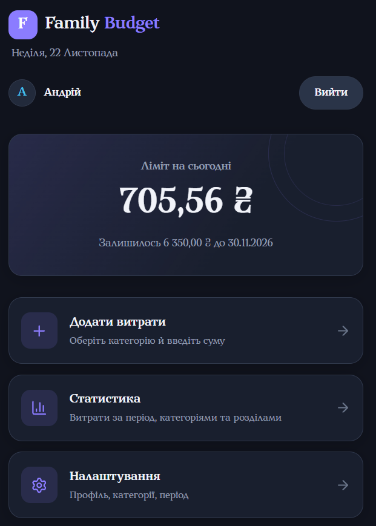
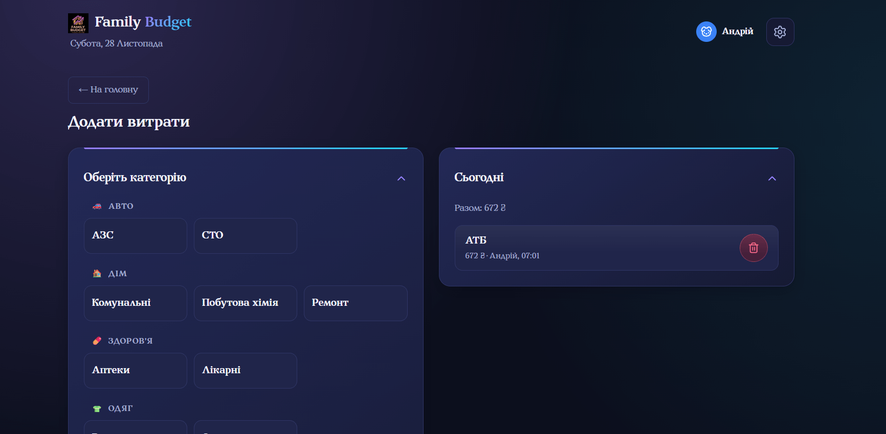
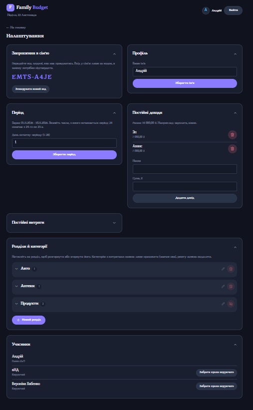
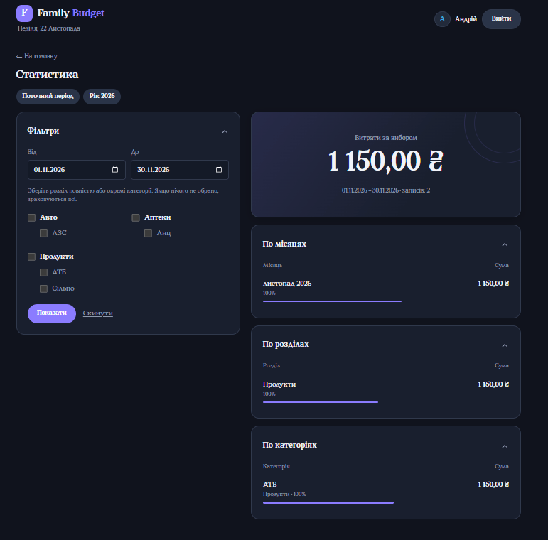

# Family Budget

Веб-застосунок для обліку сімейного бюджету. Показує, скільки можна витратити сьогодні, зберігає витрати за категоріями й розділами та будує статистику за будь-який період. Кожна сім’я працює у власному просторі.

**Демо:** https://ВАШ-ПРОЕКТ.vercel.app

> Вихідний код закритий. Цей репозиторій містить лише опис і скріншоти.

## Скріншоти

| Головна                          | Додавання витрат                              |
| -------------------------------- | --------------------------------------------- |
|  |  |

| Налаштування                              | Статистика                                |
| ----------------------------------------- | ----------------------------------------- |
|  |  |

## Можливості

- **Ліміт на сьогодні.** Автоматичний розрахунок із урахуванням доходів і витрат.
- **Облік витрат.** Категорія, сума, дата; зберігається, хто і коли вніс запис.
- **Розділи й категорії.** Власна структура витрат з іконками.
- **Розрахунковий період.** Календарний місяць або від зарплати до зарплати.
- **Статистика.** Вибірка за датами, розділами й категоріями з розбивкою по місяцях.
- **Сім’я та ролі.** Окремі акаунти, вступ за кодом із підтвердженням, різні права доступу.
- **Журнал змін.** Кожна зміна фіксується з вказанням автора.
- **Адаптивний інтерфейс.** Зручно користуватись із телефона.

## Технології

Next.js 16 · React 19 · TypeScript · MongoDB · Better Auth · Zod · CSS Modules

## Автор

**Andrii Mitko**, веб-розробник

[Portfolio](https://andrii-mitko-brand.vercel.app) · [GitHub](https://github.com/Andrii-Mitko)

## Ліцензія

© 2026 Andrii Mitko. **Усі права захищені.** Копіювання, розповсюдження й комерційне використання матеріалів без письмового дозволу автора заборонені.
